# Musify

A Spotify-style music player for iPhone, Android and the Mac that plays
**your own music files**, with YouTube on top when you want it.

<p align="center">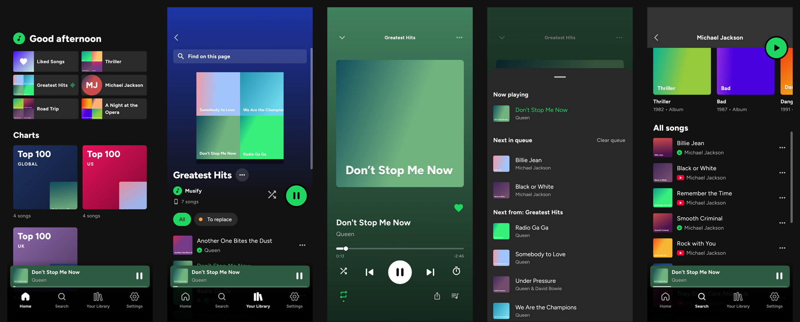</p>

> **Made entirely by Claude.** Every line of this app, its
> [server](https://github.com/fatmachines/musify_backend), the tests, the
> screenshots and this README were written by Claude (Anthropic's AI) in
> Claude Code. A person decided what it should do, tried it on their iPhone
> and Mac, and reported back what to change; Claude did the rest.

There are two halves:

- **Offline, on its own**: your folders, playlists, likes, tags, the queue,
  the equalizer, lock screen, Siri. No account, no server, nothing leaves
  the device.
- **With your own server** (optional,
  [musify_backend](https://github.com/fatmachines/musify_backend)): YouTube
  Music search, artists, albums and charts, downloads into your folders,
  and sync between your devices: playlists, what's playing, and the music
  files themselves.

## Download

- **Mac** (`.dmg`) and **Android** (`.apk`): from
  [Releases](https://github.com/fatmachines/musify_frontend/releases/latest).
  On Android, allow installing from your browser or Files when it asks.
- **iPhone**: build it yourself (below); Apple doesn't allow installing apps
  from outside the App Store.

## Offline: your folders are your library

Add a folder (from Files on iPhone, the open panel on the Mac, the file
picker on Android) and every folder in it that holds songs becomes a
playlist. Folders inside folders become playlists of their own, not merged
into their parent, so the way you already sort your music is the way it
shows up:

```
Music/
├── Michael Jackson/
│   ├── Thriller/               → playlist "Thriller"
│   └── Bad/                    → playlist "Bad"
└── Queen/
    ├── A Night at the Opera/   → playlist "A Night at the Opera"
    └── Greatest Hits/          → playlist "Greatest Hits"
```

<p align="center">
  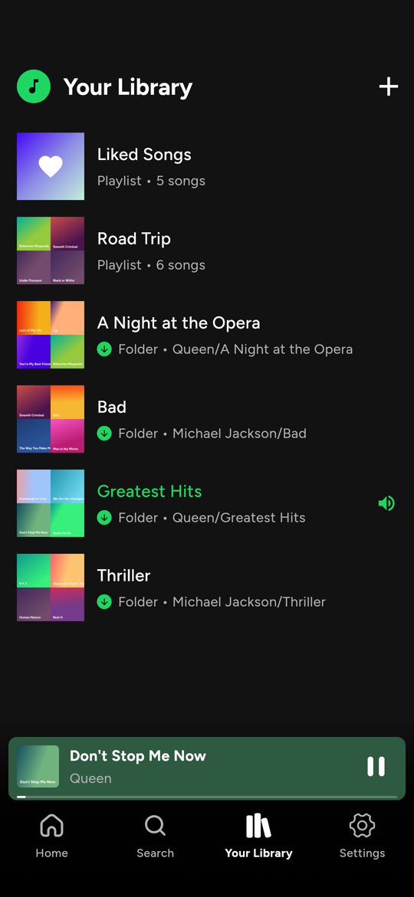
  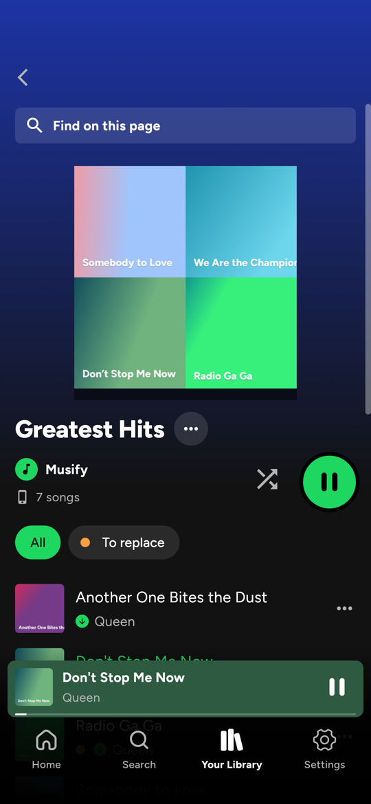
  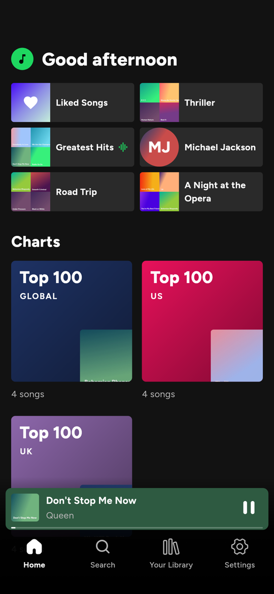
</p>

- **Files stay files.** Musify reads MP3, M4A/AAC, FLAC, WAV, OGG and more,
  with titles, artists, covers and lyrics from their tags. Nothing is
  copied or converted. Add as many folders as you like; **Rescan** (or
  pull down) picks up songs you add later.
- **Folders can be managed from the app**: rename a folder (it's renamed
  on disk; its songs stay in your playlists, likes and tags, and what's
  playing carries on), hide a folder you don't want to see, move a song to
  another folder, or delete songs from the device.
- **Your own playlists** mix songs from any folder (and YouTube songs, if
  you use the server). **Liked Songs** like Spotify's. **Tags** are coloured
  labels ("To replace", "Gym") that work as playlists of their own.
- **Home** shows what you pinned: any playlist, folder, tag, Liked Songs,
  and (with the server) artists and albums.
- **Find on this page** in every playlist (⌘F / Ctrl+F on the Mac).

### The queue, the way Spotify does it

<p align="center">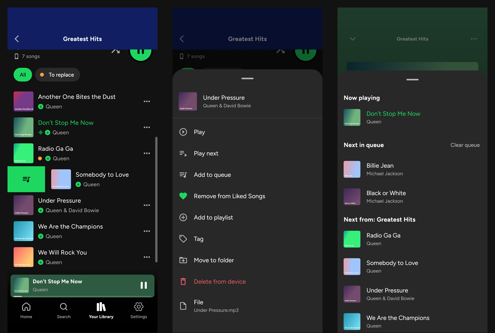</p>

- **Swipe a song to the right** anywhere (a folder, a playlist, search
  results) and it's added to the queue, with a little bump so you feel it.
  **Swipe left** to tag it, or to take its tags off.
- **Play next** puts a song right after the one playing: queue three with
  Play next and the last one you picked plays first. **Add to queue** puts
  it after the songs already queued. Both come before the rest of the
  playlist.
- **The queue is yours.** Queued songs play once and leave. They survive
  skipping, going back, starting another playlist and turning shuffle on
  or off (shuffle only reorders the rest of the playlist, never your
  queue). **Clear queue** when you're done with it.
- The queue sheet shows exactly what's coming: **Now playing**, **Next in
  queue**, then **Next from: <playlist>**. Tap any song to jump to it.
- **Swipe the mini player or the cover** sideways for the next or previous
  song, like Spotify. Drag the mini player up to open the player, the
  player down to close it.
- YouTube songs (with the server) behave the same: queue them, swipe them,
  put them in playlists.

### The player

<p align="center">
  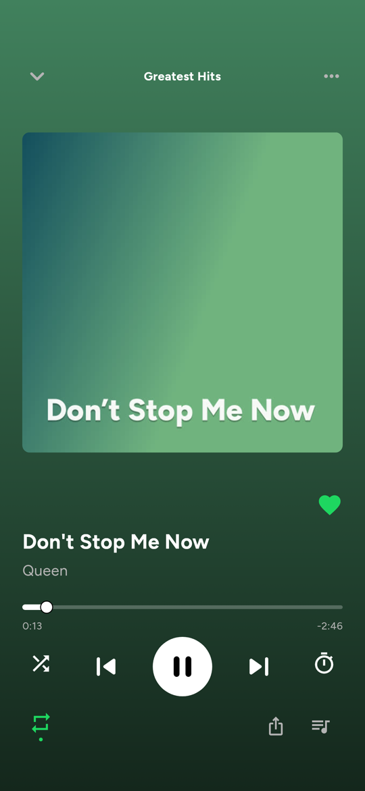
  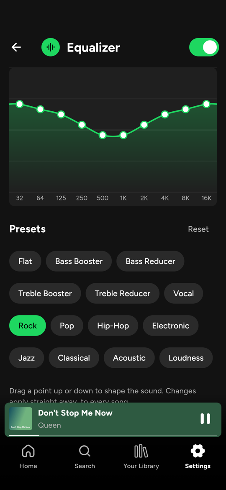
  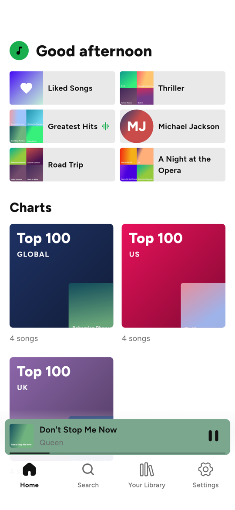
</p>

- Shuffle, repeat (all, one, off), a **sleep timer** (minutes or the end of
  the song), lyrics from the file's tags, share.
- **Equalizer**: 10 bands you drag into shape, and presets (Rock, Bass
  Booster, Vocal and more), on iPhone, Mac and Android.
- **Lock screen and Control Center**, AirPods and headphone buttons,
  **Siri** ("play Thriller on Musify"), **Android Auto**, and CarPlay's Now
  Playing.
- **Light or dark**, or as the device is set.
- Comes back after a restart paused where you left off, queue and all.

### On the Mac

A desktop layout on a wide window: your library in a sidebar, search on
top, the player across the bottom. Space plays and pauses.

<p align="center">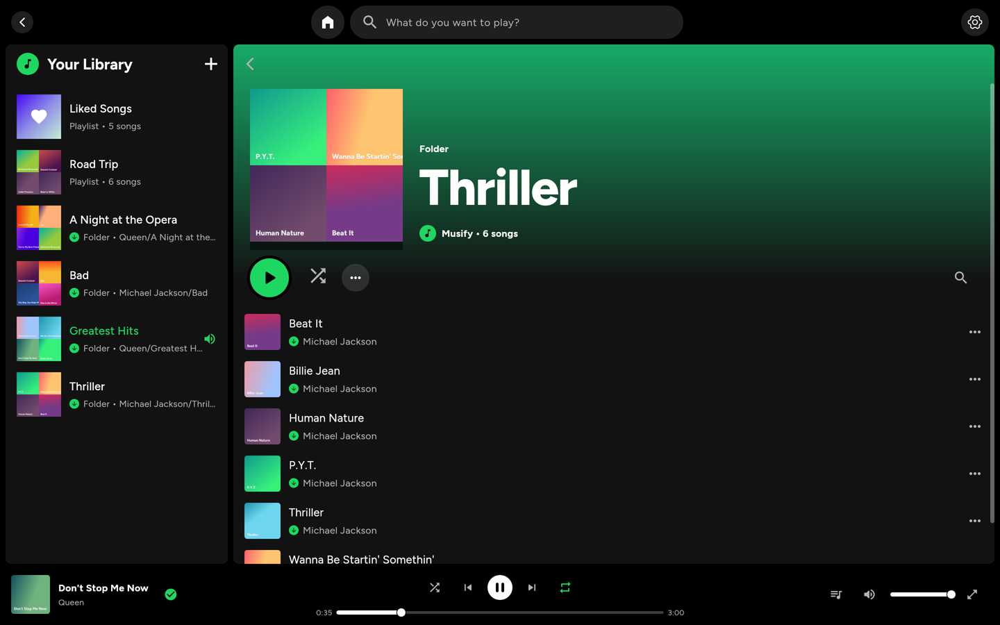</p>

## With your server: YouTube, downloads and sync

Run [musify_backend](https://github.com/fatmachines/musify_backend) (one
small Docker container; its README walks through it), enter its address
and key in **Settings → Musify server**, and you also get:

### YouTube Music, but it plays like your own songs

<p align="center">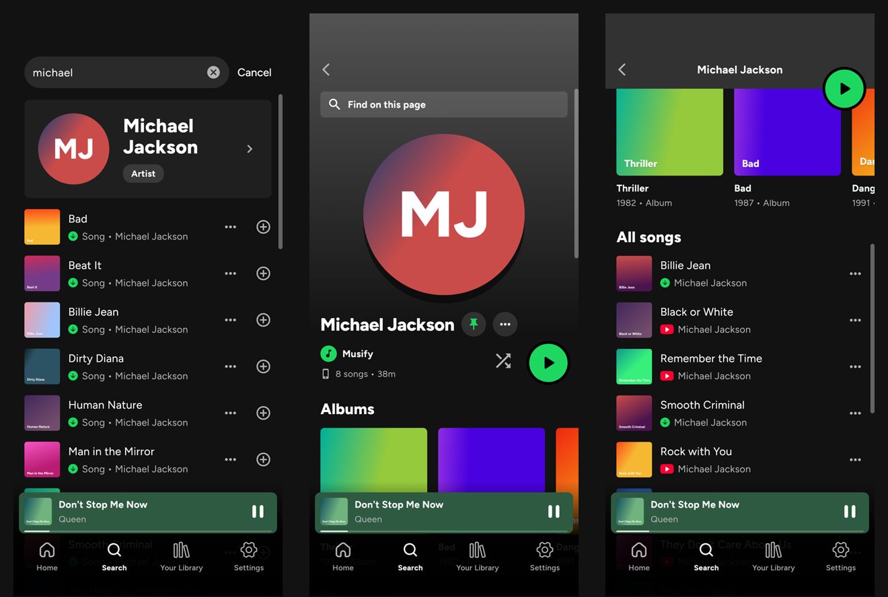</p>

- **Search** shows your own songs first, then the artist, then YouTube
  Music's songs (songs only: no videos, mixes or podcasts).
- **Artist pages** with all their songs and their albums; **album pages**.
  **Pin an artist or an album** to Home.
- **Charts** on Home: YouTube Music's Top 100 (Global, US, UK, Canada,
  Australia, India).
- **Import a playlist** from YouTube, YouTube Music or Spotify by its link
  (Your Library → **+** → Import playlist): it becomes one of your
  playlists, its songs on the device play from there, and it can be
  downloaded whole. A Spotify playlist is read in full (no Spotify account
  needed) and each song is found on YouTube Music; the few that aren't
  there are listed.
- YouTube songs stream from your server and play like any other song (no
  ads): the queue, the lock screen, playlists and Liked Songs, in the
  background and after a call. The server fetches the next ones ahead, so
  they start right away.
- **Already on your device? It plays from the file.** A YouTube song you
  downloaded, or one you already had (same title and artist, or the same
  length), plays from your folder and gets the green downloaded mark. An
  artist with 150 songs, 10 of them yours, plays those 10 from your files
  and the rest from YouTube.

### Downloads

Save a YouTube song, or a whole playlist, artist or album, as M4A (AAC as
YouTube has it, not re-encoded) with its title, artist and cover, into a
folder of yours. Downloading one of your own playlists turns it into a
folder playlist. Songs you already have are skipped.

### Sync between your devices

<p align="center">
  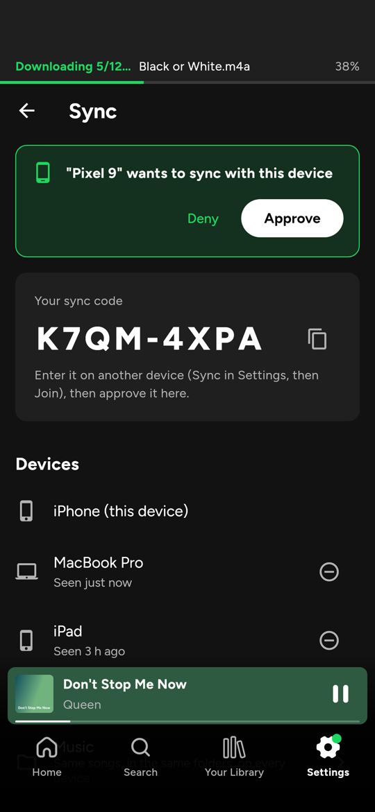
  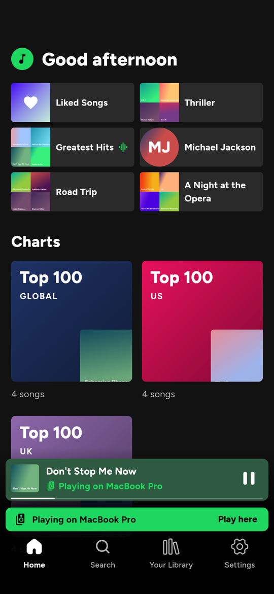
</p>

- **One device starts a sync group** and shows a code; another device
  enters it and **asks to join**, and you approve it on a device that's
  already in. No accounts.
- **Your library everywhere**: playlists, tags, Liked Songs and Home pins,
  merged item by item, so editing on two devices doesn't lose either
  change.
- **What's playing**: pause on the Mac, open the iPhone, and it's on the
  same song at the same second. While one device plays, the others show
  **"Playing on MacBook Pro"** and their play, pause, skip and seek
  buttons control that device. **Play here** moves the music over.
- **Your music files** (pick a folder on each device): songs are mirrored
  in the same subfolders, and moving, renaming or deleting them on one
  device does the same on the others. The server never keeps your library:
  devices tell it which songs they have, only a song another device lacks
  is uploaded, and it's deleted as soon as every device has it. Songs a
  device already has (a copied folder) never move at all.
- It watches the folder, so songs you drop in (in Finder or Files) are
  picked up by themselves. If most of a folder suddenly goes missing (a
  drive not mounted), it refuses to delete them everywhere.

## Build

You need [Flutter](https://docs.flutter.dev/get-started/install) 3.47 or
newer (Dart 3.13), and Xcode for iPhone or Android Studio / the Android SDK for Android.

```sh
git clone https://github.com/fatmachines/musify_frontend.git
cd musify_frontend
flutter pub get
flutter run            # on a connected phone
```

### iPhone

1. Open `ios/Runner.xcworkspace` in Xcode.
2. **Runner → Signing & Capabilities**: pick your team, and change the bundle
   identifier (`com.fatmachines.musify`) to one of your own.
3. Keep the capabilities: **Background Modes → Audio** (playing with the
   screen locked) and **Siri** (voice requests, set in
   `ios/Runner/Runner.entitlements`). Siri needs a paid Apple Developer
   account; with a free one, remove it there (the app then simply skips
   Siri).
4. `flutter run`, or Run in Xcode.

CarPlay needs Apple's CarPlay audio entitlement, which Apple gives on
request; without it Musify shows in CarPlay's Now Playing only.

### Mac

```sh
flutter run -d macos
```

or open `macos/Runner.xcworkspace` in Xcode, pick your team under **Runner →
Signing & Capabilities**, and Run. On a wide window Musify switches to a
desktop layout (library sidebar, search bar on top, player across the
bottom; space plays and pauses). The app is sandboxed: music folders are
added with the open panel and stay readable across launches. Debug builds
(`flutter run`) are `com.fatmachines.musify.dev`, with their own data, so
they don't clash with a signed release build installed on the same Mac.

To hand the Mac app to others, `scripts/make_dmg.sh` builds it, signs it
with your Developer ID, packs `dist/Musify-<version>.dmg` and has Apple
notarize it, so it opens without a warning. The script's header lists the
one-time setup (certificate and notarization credentials).

### Android

Change `applicationId` in `android/app/build.gradle.kts` if you publish your
own build, then `flutter run`. `scripts/make_apk.sh` builds a release APK
into `dist/`, signed with your key from `android/key.properties` (its
header shows how to make one).

## Connect your server

Deploy the [backend](https://github.com/fatmachines/musify_backend) (its
README walks through it), then in the app: **Settings → Musify server**,
and enter its address and key. Or build them in:

```sh
flutter run --dart-define=MUSIFY_SERVER=https://musify.example.com \
            --dart-define=MUSIFY_KEY=<your key>
```

## Development

```sh
flutter analyze
flutter test
```

- `packages/just_audio` is a copy of [just_audio](https://pub.dev/packages/just_audio)
  with Musify's iOS equalizer (`MusifyEqualizer.m`); otherwise unchanged.
- `ios/Runner/AppDelegate.swift` holds the native parts: folder access
  (security-scoped bookmarks) and Siri.
- YouTube playback: with a server, YouTube songs stream from its
  `/audio/<id>.m4a`. Without one (or if that fails),
  `lib/services/youtube/youtube_web_player.dart` keeps YouTube's mobile
  player in a hidden web view in step with the app's player, which plays
  silence of the same length for each YouTube song.

## Made by Claude

Musify was built from start to finish by Claude, Anthropic's AI, working in
Claude Code: the Flutter app (iPhone, Android, Mac), the native iOS and Mac
parts (folder access, Siri, the equalizer), the Python server, the sync
protocol, the tests that run both together, and the screenshots above
(rendered by a test, with made-up sample files). The person behind it
didn't write its code: they said what they wanted, used it every day,
and sent back bugs and screen recordings.

## Use responsibly

Musify is for your own listening. Download only what you have the right to,
and respect YouTube's terms where you live.
